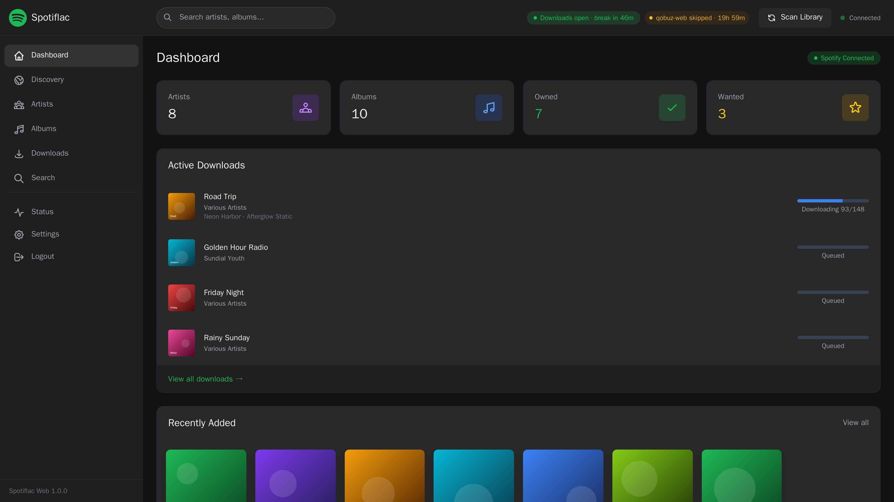

# Spotiflac web

A self-hosted web application for managing your music library with SpotiFLAC integration. Think of it as Lidarr, but specifically designed for high-quality FLAC downloads via SpotiFLAC.




## Quick Start

### Using Docker Compose

This repository is a modified fork of [NotLugozzi/Spotiflac-web](https://github.com/NotLugozzi/Spotiflac-web); see `CHANGELOG.md` for what changed. The image is built locally from `./src` (works on ARM64 hosts such as a Raspberry Pi).

1. **Get the source** and open the project folder (the one containing `docker-compose.yml`).

2. **Configure environment**
   ```bash
   cp .env.example .env
   # Edit .env (Spotify API credentials are optional)
   ```

3. **Create the data folders** (the container runs as uid 1000; if Docker creates them, they're owned by root and SpotiFLAC can't write)
   ```bash
   mkdir -p data/spotiflac_home downloads
   sudo chown -R 1000:1000 data downloads
   ```

4. **Build and start**
   ```bash
   docker compose up -d --build
   ```

5. **Access the web interface**
   ```
   http://localhost:5900
   ```
   (`docker-compose.yml` maps host port 5900 to the container's 8080.)

## Development prerequisites

1. **Prerequisites**
   - Python 3.11+
   - FFmpeg (for audio processing)

2. **Install dependencies** (the application lives in `src/`)
   ```bash
   cd src
   python -m venv venv
   source venv/bin/activate
   pip install -r requirements.txt
   ```
   Downloads additionally need SpotiFLAC in its own venv at `/opt/spotiflac-venv` (see `src/Dockerfile`); the Docker image is the supported way to run them.

3. **Configure environment**
   ```bash
   cp ../.env.example .env
   # Edit .env with your settings
   ```

4. **Run the application**
   ```bash
   DEBUG=true python -m app.main
   ```

## Configuration

### Environment Variables

| Variable | Description | Default |
|----------|-------------|---------|
| `SPOTIFY_CLIENT_ID` | Spotify API Client ID (optional) | *(empty)* |
| `SPOTIFY_CLIENT_SECRET` | Spotify API Client Secret (optional) | *(empty)* |
| `SPOTIFY_CLIENT_ID_BACKUP` / `SPOTIFY_CLIENT_SECRET_BACKUP` | Optional second Spotify app, used for an endpoint while the main app is rate limited on it | *(empty)* |
| `MUSIC_LIBRARY_PATH` | Path(s) to scan for existing music (comma-separated) | `/music` |
| `DOWNLOAD_PATH` | Path for downloaded files | `/app/downloads` |
| `SPOTIFLAC_SERVICE` | SpotiFLAC 5 extension IDs, tried in order (comma-separated); `ext:qobuz-web` always goes last | `ext:tidal-web,ext:amazon,ext:qobuz-web` |
| `QOBUZ_COOLDOWN_HOURS` | When a qobuz request is rate limited, end the qobuz phase and skip qobuz for this long instead of waiting and retrying (repeated qobuz 429s escalated to a 24 h block) | `24` |
| `VERIFY_STOP_COUNT` | After this many "verification required" (HTTP 428) refusals in one run, stop and pause like a rate limit; `0` = off | `5` |
| `VERIFY_STOP_MINUTES` | How long that pause lasts | `30` |
| `MAX_CONCURRENT_DOWNLOADS` | Tracks downloaded at once (`1` is gentler on the download service) | `2` |
| `EXT_RUNTIME_RESTARTS` | Restarts per run of a crashed extension process (amazon and other JS extensions run in Node); after that, calls to it fail for the rest of the run; `0` = off | `5` |
| `ALLOW_LOSSY_FALLBACK` | Allow lossy/metadata-only providers (ytmusic, soundcloud, apple-music), only after every lossless one | `false` |
| `ACCEPT_ISRC_MISMATCH` | Accept a file with a different ISRC than Spotify's when title, artist and version match and the length is within `ISRC_MISMATCH_MAX_SECONDS` (may occasionally file a remaster or cover) | `false` |
| `ISRC_MISMATCH_MAX_SECONDS` | Length tolerance for the above | `2` |
| `LIBRARY_CHECK_HOURS` | Every N hours remove `.flac` files that aren't FLAC (deleted; moved to `downloads/.rejected/` with lossy allowed) and their history entries, so they download again; `0` = off. `POST /api/library-check` runs it now | `6` |
| `BREAK_PAUSE_RUNNING` | Also stop a running job before a scheduled break (filed tracks kept, resumes after the break) | `true` |
| `BREAK_STOP_LEAD_SECONDS` | How long before the break a running job stops (the break time is worked out to the second) | `60` |
| `BREAK_RESUME_STABLE_SECONDS` | After a break or outage, start only once the servers have been up this long | `180` |
| `BREAK_DOWN_STOP_MINUTES` | Outside a break, stop a running job only if the servers stay down this long | `5` |
| `BREAK_MIN_WINDOW_MINUTES` | Don't start a run this close to the next break | `8` |
| `RUNNER_IDLE_MINUTES` | Kill a download run (and its browser/Node helpers) that printed nothing this long; the attempt counts as a failed try; `0` = off | `30` |
| `TRACK_FAIL_LIMIT` / `TRACK_FAIL_RETRY_DAYS` | Skip a track for a provider after this many lasting failures there (wrong match, not found, wrong length), for this many days; shown as "Skipped" in Track History with a "Try again" button; `0` = never skip | `2` / `7` |
| `DAILY_TRACK_CAP` | Download at most this many tracks per rolling 24 h; the job stops at the cap and resumes as older downloads age out. The download service has given 24 h penalties after 526–1,166 downloads a day: keep it around **400–500**; `0` = no cap | `700` |
| `QUOTA_MODE` | `dynamic`: learn the daily cap from our own penalties (after a penalty `QUOTA_BACKOFF` × the downloads before it; +`QUOTA_STEP` after each clean day at the cap, up to `QUOTA_CEILING` × the lowest trigger of the last `QUOTA_MEMORY_DAYS` days, within `QUOTA_MIN`–`QUOTA_MAX`). Seeded from the Status page history; shown and resettable in Settings → Maintenance, `GET`/`DELETE /api/quota`. `fixed` = use `DAILY_TRACK_CAP` | `fixed` |
| `HOURLY_TRACK_CAP` | Download at most this many tracks per rolling hour (burst guard: every penalty so far followed a day with a 236–309 download hour); `0` = off | `120` |
| `CAP_RESUME_RATIO` | Once the daily or hourly cap is hit, resume only when the count is back down to this share of it | `0.85` |
| `QUOTA_MIN` / `QUOTA_MAX` / `QUOTA_STEP` | Dynamic cap bounds and daily step | `200` / `1000` / `25` |
| `QUOTA_BACKOFF` / `QUOTA_CEILING` / `QUOTA_MEMORY_DAYS` | Cut after a penalty, ceiling factor, how long a penalty limits the ceiling | `0.8` / `0.9` / `7` |
| `MIN_FREE_GB` | Hold jobs while the downloads disk has less than this many GB free (a running job stops, keeps what it has, and resumes once there's room); `0` = off | `10` |
| `SPOTIFLAC_RETRY_MINUTES` | How long a failed job keeps retrying | `30` |
| `SPOTIFLAC_REGISTRIES` | Extension registry URLs (comma-separated; empty = SpotiFLAC defaults) | *(empty)* |
| `SPOTIFLAC_DEBUG` | Verbose SpotiFLAC / Turnstile logging | `0` |
| `SPOTIFLAC_PLAYLIST_FOLDER_STRUCTURE` | Top folder for playlist downloads | `{playlist_name}` |
| `SPOTIFLAC_FOLDER_STRUCTURE` | Folders below it (and for albums/tracks) | `{album_artist}/[{year}] {album}` |
| `SPOTIFLAC_ALBUM_TRACK_FORMAT` / `SPOTIFLAC_SINGLE_TRACK_FORMAT` | File name (`{track}` is the album track number) | `{track} - {artists} - {title}` |
| `HISTORY_SKIP_REDOWNLOAD` | Don't re-download tracks in Track History, even if the file was moved away | `true` |
| `BREAK_STATUS_URL` | Download-server status page polled for scheduled breaks | `https://spotbye.qzz.io/api/status` |
| `BREAK_POLL_SECONDS` / `BREAK_GATE_DOWNLOADS` | Poll interval; hold the queue during breaks | `60` / `true` |
| `DISCOVERY_MAX_API_CALLS` / `DISCOVERY_MIN_INTERVAL_HOURS` | Spotify API budget per Discovery run; minimum time between full runs | `40` / `24` |
| `SPOTIFY_DISCOVERY_MAX_PLAYLISTS` / `SPOTIFY_DISCOVERY_MAX_CATEGORIES` | Discovery size per category / number of categories | `20` / `15` |
| `SCAN_INTERVAL_MINUTES` | Auto-scan interval | `60` |
| `AUTO_SCAN_ON_STARTUP` | Scan library on startup | `true` |
| `AUTH_USERNAME` | Basic auth username (optional) | |
| `AUTH_PASSWORD` | Basic auth password (optional) | |
| `SECRET_KEY` | Session secret key | *replace the default string* |
| `LOG_LEVEL` | Logging level | `INFO` |
| `ACCESS_LOG_HIDE_POLLING` | Hide the UI's polling requests from the access log | `true` |

See `.env.example` for the full list with comments.

### Spotify API Credentials (Optional)

Spotify API credentials are **optional**. Without them, you can still:
- Download music using **Direct URL input** (paste Spotify URLs directly)
- Manage your existing local music library
- Scan and organize your music files

With Spotify API credentials, you get:
- Automatic artist/album matching from your local library
- Search integration to find new music
- Metadata fetching (album art, release dates, etc.)
- Complete discography discovery for artists

**To get credentials:**

1. Go to [Spotify Developer Dashboard](https://developer.spotify.com/dashboard)
2. Log in with your Spotify account
3. Click "Create app"
4. Fill in the app name and description
5. Under "Which API/SDKs are you planning to use?" tick **Web API** only (the others are for ads, in-browser playback and mobile apps; none are used here)
6. Enter a Redirect URI such as `http://127.0.0.1:8888/callback` (required by the form, never used: the app logs in with client credentials; `localhost` is not accepted)
7. Copy the **Client ID** and **Client Secret** into `SPOTIFY_CLIENT_ID` / `SPOTIFY_CLIENT_SECRET` in `.env`, then `docker compose up -d`

**Rate limits and the backup app:** a Spotify 429 never hangs the app; the affected endpoint (`/playlists`, `/search`, …) is skipped until its cooldown passes (`data/.spotify_ratelimit.json`). Spotify counts quota per app, so you can optionally create a second app the same way and set `SPOTIFY_CLIENT_ID_BACKUP` / `SPOTIFY_CLIENT_SECRET_BACKUP`: calls then go to the backup while the main app is cooling down on that endpoint. Note that Spotify's developer terms don't allow using several apps to get around rate limits.

The Settings page shows all four credentials masked to their last character; they can only be changed in `.env`. Spotify credentials are not used for downloading, which goes through SpotiFLAC's own lookup and download providers.

### Docker Volumes

| Volume | Purpose | Mount Point |
|--------|---------|-------------|
| `spotiflac_data` | Database persistence | `/app/data` |
| Your music library | Existing music files | `/music` (read-only) |
| Downloads folder | New downloads | `/app/downloads` |

your music library and the download folder can coexist in the same directory, if you want to avoid having to move or symlink things manually
## Usage

### Dashboard

The dashboard provides an overview of your library with:
- Statistics (artists, albums, owned, wanted)
- Active downloads with progress
- Recently added albums
- Quick actions (scan, search, settings)

### Artists

- View all artists in your library
- Click an artist to see their full discography
- Sync with Spotify to discover missing albums
- Monitor artists for automatic downloads

### Albums

- Browse all albums with filters (owned, wanted, missing)
- View album details with track listings
- Queue albums for download
- Mark albums as "wanted" for later

### Downloads

- Queue with live progress (`N / M tracks`), covers for albums, tracks and playlists
- **Download next** moves a queued job to the front (the running one steps aside and resumes right after)
- **Waiting** state instead of failures during scheduled server breaks (top-bar indicator) and download-service rate limits; jobs resume on their own
- Files are laid out as `<Playlist>/<Album Artist>/[<Year>] <Album>/<NN> - <Artists> - <Title>.flac`, with an `.m3u8` per playlist
- Tracks already in the downloads folder, or recorded in **Track History** (even if moved elsewhere, e.g. to Plex), are not downloaded again
- Track History: searchable list of every saved track
- Download history with retry options

### Search & Direct URL Download

**With Spotify API configured:**
- Search your local library
- Search Spotify for new music
- Click "Download" on any search result

**Without Spotify API (or anytime):**
- Use the **Direct URL Download** section
- Paste any Spotify URL (album, track, artist, or playlist)
- Supports multiple URLs at once (one per line)
- URLs can be in any format:
  - `https://open.spotify.com/album/xxxxx`
  - `https://open.spotify.com/track/xxxxx`
  - `https://open.spotify.com/artist/xxxxx`
  - `https://open.spotify.com/playlist/xxxxx`
  - `spotify:album:xxxxx` (URI format)

## API Documentation

### Endpoints

#### Library

| Method | Endpoint | Description |
|--------|----------|-------------|
| GET | `/api/library/stats` | Get library statistics |
| POST | `/api/library/scan` | Start a library scan |
| GET | `/api/library/scan/status` | Get current scan status |
| GET | `/api/library/scan/history` | Get scan history |

#### Artists

| Method | Endpoint | Description |
|--------|----------|-------------|
| GET | `/api/artists` | List all artists |
| GET | `/api/artists/{id}` | Get artist details |
| GET | `/api/artists/{id}/albums` | Get artist's albums |
| POST | `/api/artists/{id}/sync` | Sync with Spotify |
| PATCH | `/api/artists/{id}` | Update artist settings |

#### Albums

| Method | Endpoint | Description |
|--------|----------|-------------|
| GET | `/api/albums` | List all albums |
| GET | `/api/albums/{id}` | Get album details |
| PATCH | `/api/albums/{id}` | Update album settings |
| POST | `/api/albums/{id}/refresh` | Refresh from Spotify |

#### Downloads

| Method | Endpoint | Description |
|--------|----------|-------------|
| GET | `/api/downloads/queue` | Get download queue |
| GET | `/api/downloads/history` | Get download history |
| POST | `/api/downloads` | Add album to queue |
| DELETE | `/api/downloads/{id}` | Cancel download |
| POST | `/api/downloads/{id}/retry` | Retry failed download |
| POST | `/api/downloads/{id}/prioritize` | Download this job next |
| POST | `/api/downloads/url` / `/api/downloads/urls` | Queue Spotify URL(s) |
| GET | `/api/track-history?q=&limit=&offset=` | Saved-track history |

#### Search

| Method | Endpoint | Description |
|--------|----------|-------------|
| GET | `/api/search/artists?query=` | Search artists on Spotify |
| GET | `/api/search/albums?query=` | Search albums on Spotify |
| GET | `/api/search/library?query=` | Search local library |

#### System

| Method | Endpoint | Description |
|--------|----------|-------------|
| GET | `/api/settings` | Get application settings |
| GET | `/api/settings/status` | Get system status |
| GET | `/api/break-status` | Download-server break status |
| GET | `/api/status` | Download servers, Spotify API and our download-service limit |
| GET | `/api/status/history?hours=24` | State changes for the Status page (kept 30 days) |
| GET | `/api/events` | SSE stream for real-time updates |
| GET | `/health` | Health check endpoint |

## Database Schema

### Artists
- `id`: Primary key
- `name`: Artist name
- `spotify_id`: Spotify artist ID
- `spotify_url`: Spotify URL
- `image_url`: Artist image
- `genres`: JSON array of genres
- `is_monitored`: Auto-download new releases
- `local_path`: Path to local files

### Albums
- `id`: Primary key
- `name`: Album name
- `spotify_id`: Spotify album ID
- `artist_id`: Foreign key to artist
- `album_type`: album/single/compilation
- `release_date`: Release date
- `is_owned`: In local library
- `is_wanted`: Marked for download

### Tracks
- `id`: Primary key
- `name`: Track name
- `album_id`: Foreign key to album
- `track_number`: Track position
- `duration_ms`: Duration in milliseconds
- `local_path`: Path to local file

### Downloads
- `id`: Primary key
- `album_id`: Foreign key to album
- `status`: pending/queued/downloading/completed/failed/cancelled
- `progress`: Download progress (0-100), from the runner's per-track events
- `priority`: Queue order (Download next)
- `image_url`: Cover for playlist/URL downloads
- `error_message`: Error details if failed

### Track history
- `spotify_id` (unique), `isrc`, title, artists, album, album artist, year, track number
- `file_path`: Path relative to the downloads folder (kept after the file is moved away)
- `playlist`, `download_id`, `source` (`downloaded`/`existing`), first/last seen

## Development

### Project Structure

```
.
├── docker-compose.yml      # Deployment: builds ./src, maps port 5900 -> 8080
├── .env.example            # Copy to .env (git-ignored)
├── .github/workflows/      # Image build (context ./src)
├── CHANGELOG.md            # Changes on top of upstream
├── data/                   # Runtime state, created on the host (git-ignored)
├── downloads/              # Finished downloads (git-ignored)
└── src/                    # Application (Docker build context)
    ├── Dockerfile
    ├── requirements.txt
    ├── app/
    │   ├── main.py, config.py, database.py, models.py
    │   ├── routes/         # api.py, pages.py
    │   ├── services/       # download_manager, break_monitor, spotify_service,
    │   │                   # spotify_limits, update_discovery, library_scanner, ...
    │   ├── static/         # favicon.svg
    │   └── templates/      # base.html, pages/, partials/
    ├── migrations/         # SQLite migrations, run on startup
    └── scripts/            # spotiflac_runner.py (SpotiFLAC wrapper), utilities
```

### Running in Development

```bash
# From src/, with debug mode
cd src
DEBUG=true python -m app.main
```

### Tests

There is no automated test suite yet (upstream's `pytest tests/` referred to a folder that doesn't exist).

## Troubleshooting

### Common Issues

**Spotify API not connecting**
- Verify your Client ID and Secret are correct
- Check that your app has the required permissions
- Ensure no firewall is blocking outgoing connections

**SpotiFLAC downloads failing**
- A job showing **waiting** is not failing: the download servers are on a scheduled break or rate limiting, and it resumes on its own
- `Permission denied` under `/home/spotiflac/.spotiflac`: `data/spotiflac_home` and `downloads` must be owned by uid 1000
- Set `SPOTIFLAC_DEBUG=1` and recreate the container for verbose provider / Turnstile logs; runner messages appear in the app log live as `[runner] …` (per-request HTTP lines filtered out). Docker keeps up to 5 GB of logs (`logging` in `docker-compose.yml`).

**Library scan not finding files**
- Check that the music path is correctly mounted
- Verify file permissions allow reading
- Supported formats: FLAC, MP3, M4A, OGG, OPUS, WAV, AIFF

**Database errors**
- Ensure the data directory exists and is writable
- Check disk space availability
- Try deleting the database file to reset

### Logs

```bash
# Docker logs
docker compose logs -f spotiflac-web

# Log level can be adjusted via LOG_LEVEL environment variable
```

## Contributing

1. Fork the repository
2. Create a feature branch (`git checkout -b feature/amazing-feature`)
3. Commit your changes (`git commit -m 'Add amazing feature'`)
4. Push to the branch (`git push origin feature/amazing-feature`)
5. Open a Pull Request

## License

This project is licensed under the MIT License - see the [LICENSE](LICENSE) file for details.

## Acknowledgments

- [SpotiFLAC](https://github.com/afkarxyz/SpotiFLAC) - The underlying download engine
- [FastAPI](https://fastapi.tiangolo.com/) - Modern Python web framework
- [HTMX](https://htmx.org/) - High power tools for HTML
- [Tailwind CSS](https://tailwindcss.com/) - Utility-first CSS framework
- Inspired by [Lidarr](https://lidarr.audio/) and other ARR applications
